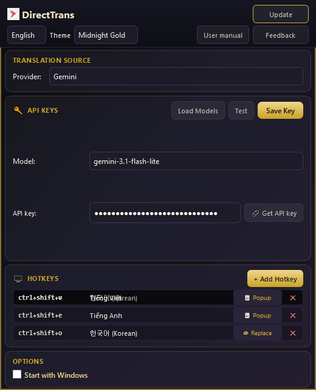
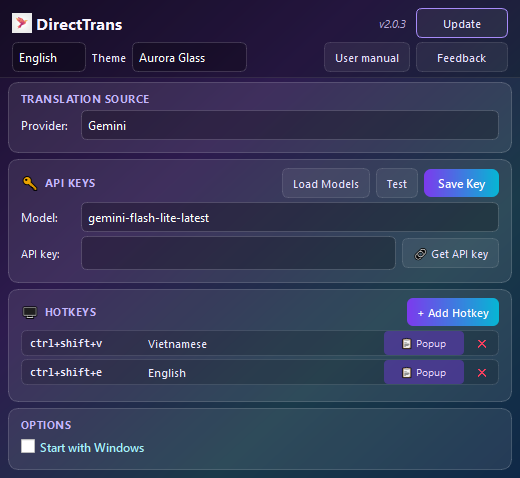
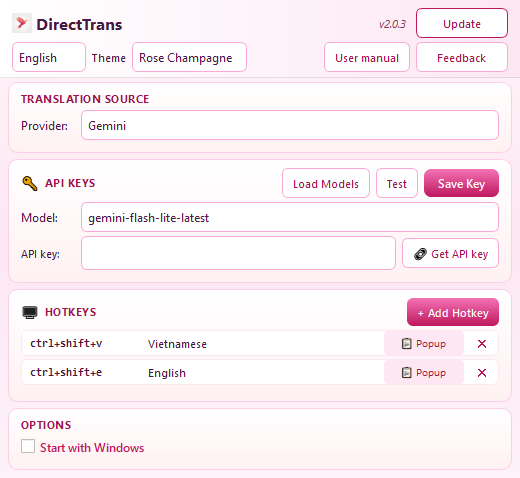
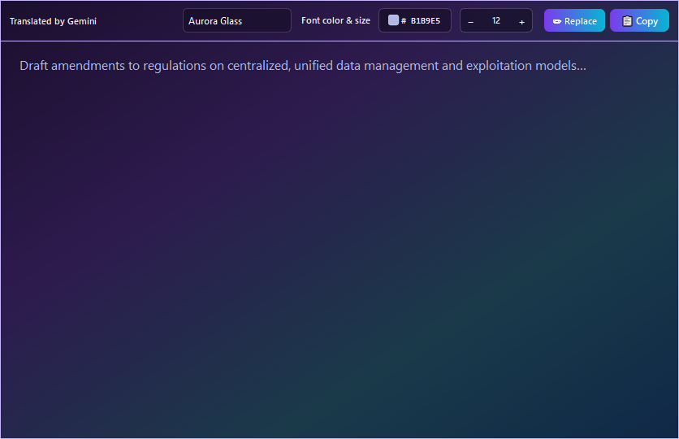

# DirectTrans

Windows background app (system tray): select text in any application, press a global hotkey to translate via AI or Google Translate, then show a popup or replace the selection in place (RTF-aware).

---

## Install (executable)

1. Download the latest `DirectTrans_v*.exe` from [Releases](https://github.com/lamvu211/Direct-Trans/releases), or build locally (see below) and use the file under `dist\`.
2. Keep the executable in a fixed folder (e.g. `C:\Apps\DirectTrans\`).
3. On first run, a **LOADING…** progress screen appears, then **Settings** opens automatically — configure your API key and hotkeys (see **User manual** in the app).
4. The app minimizes to the **system tray**. Double-click the tray icon or right-click → **Settings** to open Settings again.
5. Config is stored next to the exe (`config.json`); logs: `directtrans.log` (do not share these files — they may contain personal metadata).

> If you launch a new build while an old instance is running, the old process is stopped so the new one takes over (single instance).

---

## UI overview

### Settings

Single screen: **UI language** (Vietnamese, English, Korean, Chinese, Japanese), **theme** (Midnight Gold, Aurora Glass, Rose Champagne, Nord Snow), translation provider (Gemini / Groq / Mistral / Google Free), API key and model, hotkeys, Windows startup, update check, User manual, and Feedback.

Click thumbnails below for full-size shots, or expand each theme. Screenshots in this repo are generic UI review assets — see [docs/PUBLIC_REPO.md](docs/PUBLIC_REPO.md).

<table>
  <tr>
    <td align="center" width="25%">
      <a href="docs/ui-review/screenshots/settings_midnight_gold.png"></a><br>Midnight Gold
    </td>
    <td align="center" width="25%">
      <a href="docs/ui-review/screenshots/settings_aurora_glass.png"></a><br>Aurora Glass
    </td>
    <td align="center" width="25%">
      <a href="docs/ui-review/screenshots/settings_rose_champagne.png"></a><br>Rose Champagne
    </td>
    <td align="center" width="25%">
      Nord Snow<br><sub>Available in the app; no public review screenshot in this repo yet.</sub>
    </td>
  </tr>
</table>

<details>
<summary>🔍 Midnight Gold</summary>

</details>
<details>
<summary>🔍 Aurora Glass</summary>

</details>
<details>
<summary>🔍 Rose Champagne</summary>

</details>

### Translation popup

Shown after a **Popup** hotkey: translated text, theme, font color/size, **Copy** / **Replace**.



### System tray

Menu: pause/resume translation, open Settings, Quit.

---

## Quick start

1. **Select** text in Word, a browser, chat, etc.
2. Press your assigned **hotkey** (defaults often include Popup → Vietnamese / English).
3. **Popup:** read the result, Copy or Replace. **Replace hotkey:** replaces text without opening the popup.

For API keys, Test/Save key, hotkey management, and popup options, open **User manual** in Settings or see `src/assets/user_manual.html`.

---

## Project layout (development)

```text
direct-trans/
├── src/
│   ├── bootstrap.py         # PyInstaller entry (exe): Win32 loading → import app
│   ├── main.py              # App logic; use `python src/main.py` in dev
│   ├── win32_startup_splash.py
│   ├── config.py            # config.json, API keys (DPAPI)
│   ├── translator.py        # Gemini, Groq, Mistral, Google Free
│   ├── hotkey_manager.py    # RegisterHotKey (Windows)
│   ├── clipboard_util.py    # Copy / replace RTF
│   ├── process_util.py      # Kill stale DirectTrans processes
│   ├── assets/              # icon, user_manual.html, screenshots
│   └── ui/qt/               # Settings, popup, themes, startup_splash
├── tests/
├── scripts/                 # capture_* (review assets — see PUBLIC_REPO.md)
├── DirectTrans.spec         # PyInstaller (name follows APP_VERSION in constants.py)
├── build.bat
├── CHANGELOG.md
└── requirements.txt
```

### Run from source

```bash
pip install -r requirements.txt
python src/main.py
```

### Build executable

```cmd
.\build.bat
```

Output: `dist\DirectTrans_v<version>.exe` (version from `src/constants.py` and `DirectTrans.spec`).

### Tests

```bash
python -m pytest tests/ -q
```

Documentation screenshots:

```bash
python scripts/capture_ui_screenshots.py    # docs/ui-review — review before committing images
python scripts/capture_manual_assets.py     # src/assets — do not commit if captured with your real config
python scripts/capture_readme_settings.py   # local only → src/assets/readme/ (gitignored)
```

Public repo policy: [docs/PUBLIC_REPO.md](docs/PUBLIC_REPO.md).

---

## License

[MIT License](LICENSE)
