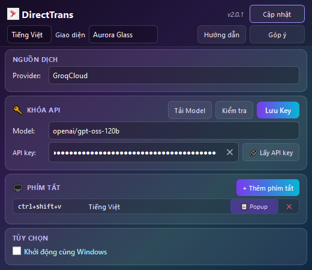

# DirectTrans

Ứng dụng Windows chạy nền (khay hệ thống): chọn văn bản trong bất kỳ app nào, nhấn phím tắt toàn cục để dịch qua AI hoặc Google Translate, hiển thị popup hoặc thay thế trực tiếp đoạn đã chọn (có hỗ trợ RTF).

---

## Cài đặt (file exe)

1. Tải `DirectTrans_v*.exe` từ [Releases](https://github.com/lamvu211/Direct-Trans/releases) (hoặc thư mục `dist` sau khi build).
2. Đặt file ở vị trí cố định (ví dụ `C:\Apps\DirectTrans\`).
3. Chạy lần đầu — cửa sổ **Cài đặt** mở tự động; cấu hình API key và phím tắt (xem **Hướng dẫn sử dụng** trong app).
4. App thu nhỏ về **khay hệ thống**. Double-click icon khay hoặc chuột phải → **Cài đặt** để mở lại Settings.
5. Cấu hình lưu cạnh file exe (`config.json`); log: `directtrans.log`.

> Chạy bản exe mới khi bản cũ còn mở: bản cũ sẽ được tắt để bản mới tiếp quản (cùng một instance).

---

## Giao diện cơ bản

### Cài đặt (Settings)

Một màn hình: ngôn ngữ UI, theme, nguồn dịch (provider), API key & model, phím tắt, tùy chọn khởi động Windows / cập nhật.



### Popup dịch

Hiện sau phím tắt chế độ **Popup**: nội dung dịch, theme, cỡ/màu chữ, **Copy** / **Replace**.


### Khay hệ thống

Menu: bật/tắt dịch tạm thời, mở Cài đặt, Thoát.

---

## Cách dùng nhanh

1. **Bôi chọn** văn bản trong Word, browser, chat, …
2. Nhấn **phím tắt** đã gán (mặc định thường có Popup → Việt / Anh).
3. **Popup:** đọc kết quả, Copy hoặc Replace. **Replace (hotkey):** thay trực tiếp không qua popup.

Chi tiết API key, Test/Save key, quản lý phím tắt, tùy chọn popup: mở **User manual** trong Settings hoặc file `src/assets/user_manual.html`.

---

## Cấu trúc dự án (dev)

```text
direct-trans/
├── src/
│   ├── main.py              # Entry, tray + Qt loop, hotkeys
│   ├── config.py            # config.json, API keys (DPAPI)
│   ├── translator.py        # Gemini, Groq, Mistral, Google Free
│   ├── hotkey_manager.py    # RegisterHotKey (Windows)
│   ├── clipboard_util.py    # Copy / replace RTF
│   ├── process_util.py      # Kill stale DirectTrans processes
│   ├── assets/              # icon, user_manual.html, screenshots
│   └── ui/qt/               # Settings, popup, themes, dialogs
├── tests/
├── scripts/                 # capture_manual_assets.py, UI screenshots
├── DirectTrans.spec         # PyInstaller
├── build.bat
└── requirements.txt
```

### Chạy từ source

```bash
pip install -r requirements.txt
python src/main.py
```

### Build exe

```cmd
.\build.bat
```

### Tests

```bash
python -m pytest tests/ -q
```

Ảnh cho tài liệu (Settings, popup, hotkey):

```bash
python scripts/capture_manual_assets.py
```

---

## License

[MIT License](LICENSE)
